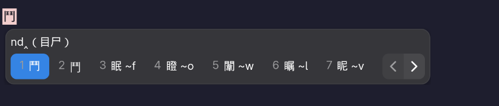
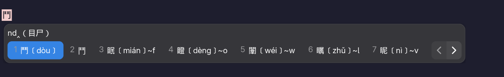
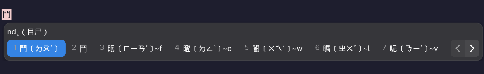
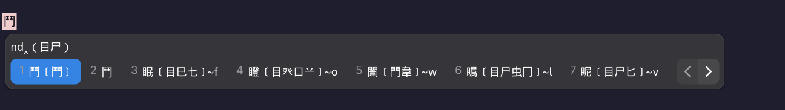
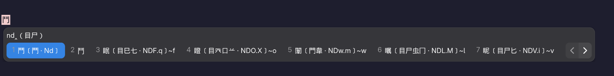
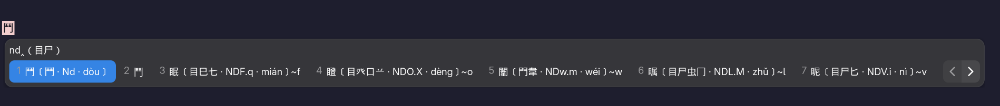
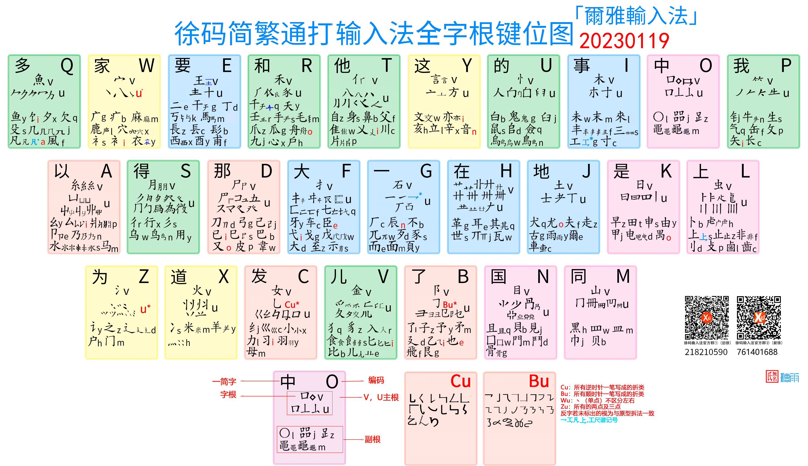

# 简介

本方案高度定制化，为本人自用，兼供徐码爱好者参考；

基于 [Rime](https://rime.im) 输入法的徐码方案，适用于 Linux（ibus）与 Windows（小狼毫）；

基于 [Ace-Who/rime-xuma](https://github.com/Ace-Who/rime-xuma)修改。

# 特性

## 合理词频

使用真实语料重排候选顺序：

- **词频来源**：十路语料加权——[jieba](https://github.com/fxsjy/jieba)（新闻书面）、[wordfreq](https://github.com/rspeer/wordfreq)（网络口语）、THUOCL（领域词表）、BCC 现代汉语及文学/口语/近代频道、SUBTLEX-CH（字幕）、Google Books 中文、国家语委词表
- **繁体查频**：繁体词条经 [OpenCC](https://github.com/BYVoid/OpenCC) TS 表转简后查表；查不到者走 Unicode Unihan kSemanticVariant 异体归一（如「彊烈」享「强烈」频次）
- **排序由行序承载**：词典 `sort: original`，同码位内单字不动、词组按混合频分降序；简码区（单字、≤3 码词组）逐字节保持原样
- **全流程可复现**：`lua/codelllc09/tools/gen_freq_dict.py`（语料清单与下载源见 `lua/codelllc09/tools/dict_pipeline/corpus/README.md`）

## 124模式

舒服的节奏。本模式仅保留**单字、二字词、四字词**。三档切换：全词 / 124（默认）/ 单字。

## 字集切换

此功能 Rime 内置（`extended_charset`），两档：

- **通用**＝只出基本区（U+4E00–9FFF，约 2.1 万字）
- **全部**＝另放开扩展区与兼容区（合计约 9.6 万字）

## 更细致的注解模式

七档循环（`xuma_spelling.*`）：

- **〇注解**：不显示任何提示
  
- **拼音**：所有候选标拼音
  
- **生僻拼音**：只为生僻字标拼音，常用字不占视觉空间（默认）
  
- **注音符**：所有候选标注音符号
  
- **一重注解**：部件拆分
  
- **二重注解**：部件拆分 + 编码
  
- **三重注解**：部件拆分 + 编码 + 拼音
  


## 非简模式

通打/非简两档，默认非简。开启时：

词表只出繁体标准形，简体仅能经简繁转换输出。此模式拦截以下简化字：

- 主要拦截集 = 会被 OpenCC s2t 转换为繁体的字 ∩ Big5 中不存在的字：前者圈出简化字，后者排除繁体标准集中也收录的传统字形
- 部分古字（如号、无）、俗字（如欢、国）放行单字，但不得参与组词
- 草体楷化偏旁（门贝见风马）及其类推字全部拦截；飞=《说文》徐注构件有出典，单字放行但不得组词（2026-09-08 裁定）

## 反查助记

忘记编码时，用**拼音 + 声调 + 笔画**组合反查全码，助你学习徐码。以反引号 `` ` `` 引导：

```
`音節[聲調][/筆畫]
```
声调与笔画为可选项。

- 声调 **，。；'** ＝ 一二三四声——它们在键盘上位置相近，方便记忆
- **/** ＝ 模糊声调（记不清声调时四声全匹配）
- 笔画键 `h`横 `s`竖 `p`撇 `n`捺 `z`折
- 声调后 `/` 可省：`` `li,hs `` ≡ `` `li,/hs ``

例： `` `li, `` → li 一声；`` `li;/hs `` → 三声∩横竖 → 李（注释带全码 `ijxj`）；

另有 `` `P `` 全拼反查、`` `B `` 五笔画反查（`hspnz`）；`U` + 十六进制码位反查（如 `U6c5f` → 江）。仅支持单音节单字查询。

## 辅助功能

- `/time` `/date`：时间日期、农历、十二时辰（午正三刻＝12:45）
- `/dx` + 数字：金额大写（支持两位小数）
- `/add`：**加词两段式**——逐字打出缺词 → 敲 `/add` → 候选尾部列出连缀词（4/3/2 字降序），
  选中即入暂存；再敲 `/add` 选「入庫重跑」固化为词条并自动重排、部署
  （收词后可直接按 `s` 入库重跑、`x` 清空暂存）。词形＝实际上屏的繁体形
- `env/` 环境变量展开；`help/` 快捷键速查
- `/jt` 等 200 余组符号（`/xz` 序号、`/rq` 日期、`/sj` 时间、`/hb` 货币…）

# 注意

词库码表较原版改动较多，且词库以繁体为主，输出简体依赖繁简转换。若日常以打简体为主，不建议使用本词库。

# 附录

## 此方案涉及快捷键

- **F4**：打开 Rime 选单——词组长短（全词/124/单字）、通打·非简、注解模式都在这里切
- **Super+F**：简繁切换（原 Ctrl+Shift+F，已让给终端搜索）
- **Ctrl+Shift+5**：字符集（通用 / 全部）
- **Ctrl+C**：注解切到指定档；**Ctrl+Shift+C**：注解循环（反查中作用于反查组）
- 分号 `;`：候选次选；引号 `'`：候选三选

以上均可在配置中自己更改（`xuma_L.schema.yaml` 的 `key_bindings` 节）。

## 方案使用方式

1. 下载本仓库（或复制 `xuma_L.schema.yaml`、`xuma_L.dict.yaml`、`xuma_spelling_pseudo.dict.yaml`、`symbols.yaml`、`lua/` 目录；`luna_pinyin`、`stroke` 依赖 Rime 发行版自带或另装）
2. Linux：放入 `~/.config/ibus/rime/`，执行 `ibus restart`；Windows：放入用户文件夹后「重新部署」
3. 依赖 librime-lua 及 librime-xuma-spelling 插件（主流 Rime 发行版已内置前者）
4. 于Rime选单中将方案切换为「徐碼·L」

## 徐码键位图



## 官方网站

- 徐码官网：http://xumax.cn/

## 致谢列表

- 徐码发明人 **徐国银** 先生
- [Ace-Who](https://github.com/Ace-Who)
- [lotem](https://github.com/lotem)（rime-zhengma，早期权重参考）
- [fxsjy/jieba](https://github.com/fxsjy/jieba)、[rspeer/wordfreq](https://github.com/rspeer/wordfreq)、[THUOCL](http://thuocl.thunlp.org/)、BCC、SUBTLEX-CH、Google Books、国家语委（词频语料）
- [BYVoid/OpenCC](https://github.com/BYVoid/OpenCC)、Unicode Unihan Database（繁简与异体数据）
