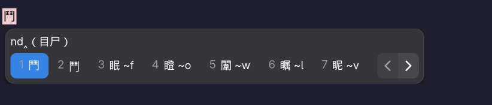
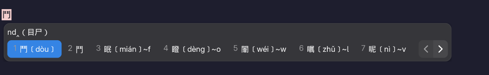
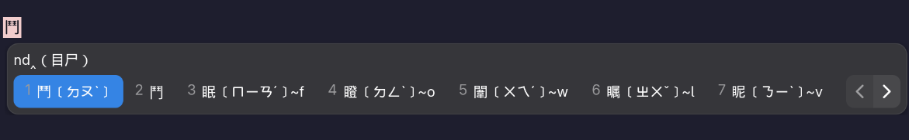
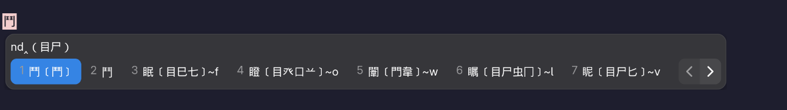
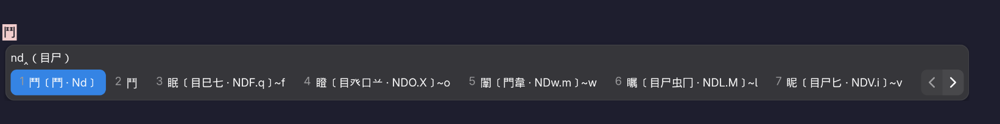
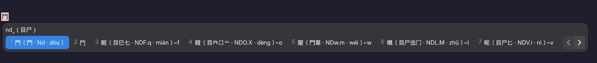
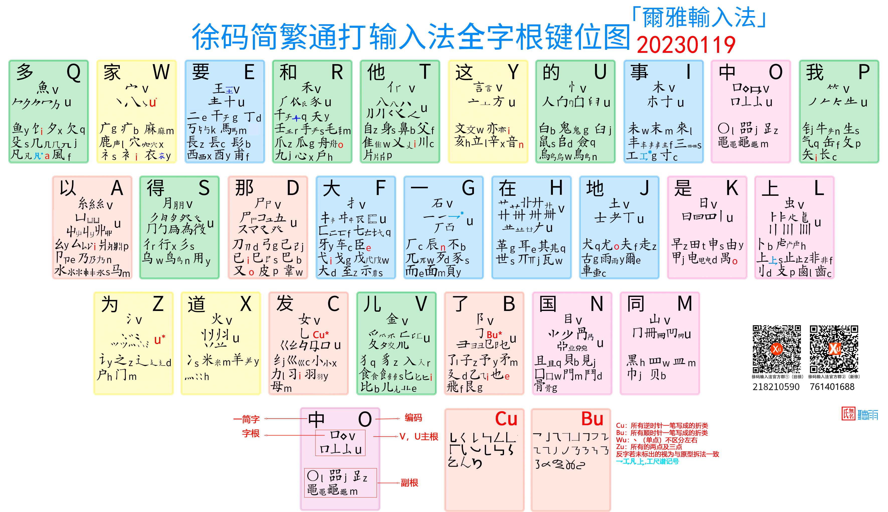

# 简介

本方案高度定制化，为本人自用，兼供徐码爱好者参考；

基于 [Rime](https://rime.im) 输入法的徐码方案，适用于 Linux（ibus）与 Windows（小狼毫）；

基于 [Ace-Who/rime-xuma](https://github.com/Ace-Who/rime-xuma)）修改。

# 特性

## 合理词频

使用真实语料重排候选顺序：

- **词频来源**：两路独立语料等权重加权（分别代表书面与口语）
  - [jieba](https://github.com/fxsjy/jieba) dict.txt（人民日报等新闻书面语，349,045 词）
  - [wordfreq](https://github.com/rspeer/wordfreq) zh（OpenSubtitles 字幕 + Twitter 聚合，38,811 词）
- **繁体查频**：繁体词条经 [OpenCC](https://github.com/BYVoid/OpenCC) TS 表转简后查表；查不到者走 Unicode Unihan kSemanticVariant 异体归一（如「彊烈」享「強烈」频次）
- **排序由行序承载**：词典 `sort: original`，同码位内单字不动、词组按混合频分降序；简码区（单字、≤3 码词组）逐字节保持原样

## 124模式

舒服的节奏。本模式仅保留**单字、二字词、四字词**。三档切换：全词 / 124（默认）/ 单字。

## 字集切换

此功能 Rime 内置（`extended_charset`），两档：

- **通用**＝只出基本区（U+4E00–9FFF，词典中 29,332 个单字）
- **全部**＝另放开扩展区（词典中 73,060 个单字）

## 更细致的注解模式

七档循环（`xuma_spelling.*`）：

- **〇注解**：不显示任何提示
  
- **拼音**：所有候选标拼音
  
- **生僻拼音**：只为生僻字标拼音，常用字不占视觉空间（默认）
  
- **注音符**：所有候选标注音符号
  
- **一重注解**：部件拆分
  
- **二重注解**：部件拆分 + 编码
  
- **三重注解**：部件拆分 + 编码 + 拼音
  


## 非简模式

通打/非简两档，默认非简。开启时：

词表只出繁体标准形，简体仅能经简繁转换输出。此模式拦截以下简化字：

- 主要拦截集 = 会被 OpenCC s2t 转换为繁体的字 ∩ Big5 中不存在的字：前者圈出简化字，后者排除繁体标准集中也收录的传统字形
- 部分古字（如号、无）、俗字（如欢、国）放行单字，但不得参与组词
- 草体楷化偏旁（门贝见风马鱼飞）及其类推字全部拦截

## 反查助记

忘记编码时，用**拼音 + 声调 + 笔画**组合反查全码，助你学习徐码：

```
音節[聲調][/筆畫]
```
声调与笔画为可选项。

- 声调 **，。；'** ＝ 一二三四声——它们在键盘上位置相近，方便记忆
- **/** ＝ 模糊声调（记不清声调时四声全匹配）
- 笔画键 `h`横 `s`竖 `p`撇 `n`捺 `z`折
- 声调后 `/` 可省： `li,hs ` ≡  `li,/hs `

例： `li, ` → li 一声； `li;/hs ` → 三声∩横竖 → 李（注释带全码 `ijxj`）；

另有  `P ` 强制拼音反查、 `B ` 五笔画反查（`hspnz`）。仅支持单音节单字查询。

# 注意

词库码表较原版改动较多，且词库以繁体为主，输出简体依赖繁简转换。若日常以打简体为主，不建议使用本词库。

# 附录

## 此方案涉及快捷键

- Ctrl+~：开启选单（核心，一切模式可在此切换）
- Ctrl+shift+c：注解切换热键：反查中按同键切换下一组
- 分号 `;`：候选次选；引号 `'`：候选三选

以上均可在配置中自己更改（`xuma_L.schema.yaml` 的 `key_bindings` 节）。

## 方案使用方式

1. 下载本仓库（或复制 `xuma_L.schema.yaml`、`xuma_L.dict.yaml`、`lua/` 目录）
2. Linux：放入 `~/.config/ibus/rime/`，执行 `ibus restart`；Windows：放入用户文件夹后「重新部署」
3. 依赖 librime-lua 及 librime-xuma-spelling 插件（主流 Rime 发行版已内置前者）
4. 于Rime选单中将方案切换为「徐碼·L」

## 徐码键位图



## 官方网站

- 徐码官网：http://xumax.cn/

## 致谢列表

- 徐码发明人 **徐国银** 先生
- [Ace-Who](https://github.com/Ace-Who)
- [lotem](https://github.com/lotem)（rime-zhengma，早期权重参考）
- [fxsjy/jieba](https://github.com/fxsjy/jieba)、[rspeer/wordfreq](https://github.com/rspeer/wordfreq)（词频语料）
- [BYVoid/OpenCC](https://github.com/BYVoid/OpenCC)、Unicode Unihan Database（繁简与异体数据）
